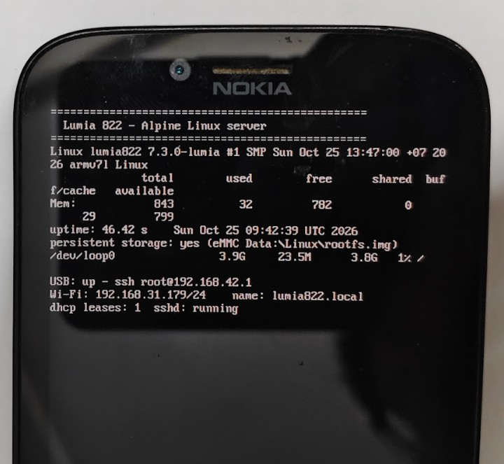

# Linux on the Nokia Lumia 822

Mainline Linux (7.3) + Alpine Linux on the **Nokia Lumia 822** (RM-845, Qualcomm MSM8960), started from
the phone's own Windows boot manager. Windows 10 Mobile stays the default OS; Linux boots when you hold
**Volume Down** while powering on.

The goal of this project is a small, always-on **home server** you can reach over SSH.

<p align="center">
  
</p>

The phone's status screen after booting Linux 7.3: persistent root on the eMMC, USB networking up, Wi-Fi
connected, reachable as `lumia822.local`, SSH running. From the PC, over Wi-Fi:

```console
$ ssh root@lumia822.local
lumia822:~# uname -sr; cat /etc/alpine-release
Linux 7.3.0-lumia
3.22.7
lumia822:~# df -h /
/dev/loop0                3.9G     23.5M      3.8G   1% /
lumia822:~# ip -4 -o addr show wlan0 | awk '{print $2, $4}'
wlan0 192.168.31.179/24
lumia822:~# iw dev wlan0 link | grep -E 'signal|tx bitrate'
	signal: -63 dBm
	tx bitrate: 13.5 MBit/s MCS 0 40MHz
lumia822:~# ping -c 2 -q 1.1.1.1 | tail -1
round-trip min/avg/max = 34.358/39.501/44.644 ms
```

| Works | Notes |
|---|---|
| Boot from the Windows boot manager | Own boot application `LL11.efi` starts the Linux EFI-stub kernel |
| Framebuffer console + status screen | EFI framebuffer (480x800) |
| eMMC (internal storage) | Windows partitions readable; NTFS Data partition read/write (`ntfs3`) |
| Persistent root filesystem | ext4 image file `C:\Data\Linux\rootfs.img` on the Windows Data partition |
| USB networking + serial console | RNDIS (phone `192.168.42.1`) + ACM serial root shell; Windows installs both automatically |
| SSH | dropbear, key-only |
| Wi-Fi (WCN3660 / Riva) | WPA2, DHCP, auto-reconnect; firmware taken from the phone's own Windows |
| mDNS | the phone answers as `lumia822.local` |
| Internet over USB | through Windows Internet Connection Sharing / NAT on the PC |
| Both CPU cores | CPU1 started from the UEFI parking-protocol mailbox (onlined by `init` after boot) |
| Battery charging | PM8921 charger to 4.1 V at about 7 W; battery voltage, temperature, estimated capacity in `/sys/class/power_supply/battery` |
| PMIC ADC and RTC | battery/USB/system voltages and temperatures (`iio:device0`, `hwmon`); RTC read-only |

| Not done (yet) | |
|---|---|
| Fuel gauge (BMS), cpufreq/cpuidle, display backlight control, touch, buttons, audio, modem, camera, GPU, Bluetooth, SD card | contributions welcome |

> [!WARNING]
> **The bootloader unlock can permanently brick your phone.** There is no public emergency loader for the
> RM-845, so a bad write to the boot partitions cannot be repaired with a cable. This software is provided
> "as is", without warranty of any kind (see [LICENSE](LICENSE)). You use it entirely at your own risk.
> Read [docs/unlock.md](docs/unlock.md) completely before you write anything.

## How it works (short)

1. **Unlock** ([docs/unlock.md](docs/unlock.md)): the WPinternals "Spec A" images (patched SBL2/SBL3/UEFI +
   a Secure-Boot-off UEFI variable store) are generated with WPinternals' own code and written from
   **inside Windows 10 Mobile** (a small `disktool.exe` running as SYSTEM through CMD Injector), because no
   emergency flash loader exists for this model.
2. **Boot chain** ([docs/boot-chain.md](docs/boot-chain.md)): the Volume-Down entry of the Windows boot
   manager is pointed at `\LL11.efi`, a self-signed Windows boot application that returns to the UEFI
   context and starts the Linux EFI-stub `zImage` with a DTB, initramfs and command line from
   `C:\EFIESP\linux\`.
3. **Kernel** ([docs/kernel.md](docs/kernel.md)): Linux 7.3 + 6 small patches, built-in drivers, no modules.
4. **Userspace** ([docs/rootfs.md](docs/rootfs.md)): Alpine 3.22 initramfs that switches into a persistent ext4
   image on the Windows Data partition.
5. **Wi-Fi** ([docs/wifi.md](docs/wifi.md)): the Riva remote processor with the phone's Windows Phone 8
   firmware, several workarounds for its 2012-era interface.

## Install

Step-by-step guide: **[docs/install.md](docs/install.md)**. In short:

1. Unlock the bootloader (once) - [docs/unlock.md](docs/unlock.md).
2. Download the [latest release](https://github.com/msshhp/lumia822-linux/releases/latest). Copy `LL11.efi`
   to `C:\EFIESP\` and the files from its `linux\` folder to `C:\EFIESP\linux\`, point the Volume-Down boot
   entry at `\LL11.efi`.
3. Put your SSH public key into `C:\EFIESP\linux\authorized_keys` and your Wi-Fi settings into
   `C:\EFIESP\linux\wpa_supplicant.conf`.
4. Power on with Volume Down held. Connect: `ssh root@lumia822.local`.
5. Run `lumia-setup` once to create the persistent root, then `lumia-reboot`.

## Build from source

| Part | Script | Runs on |
|---|---|---|
| Boot loader `LL11.efi` | [`loader/build.sh`](loader/build.sh) | Git Bash or Linux + llvm-mingw + osslsigncode |
| Kernel `zImage` | [`kernel/build.sh`](kernel/build.sh) | Linux / WSL2 + `gcc-arm-linux-gnueabihf` |
| Device tree `lumia822.dtb` | [`dts/build_base_dtb.sh`](dts/build_base_dtb.sh), then [`dts/build_wifi_dtb.sh`](dts/build_wifi_dtb.sh) | Git Bash or Linux + .NET 8 SDK (`tools/dotnet/fdttool`) |
| Initramfs `initramfs.gz` | [`rootfs/build_rootfs.sh`](rootfs/build_rootfs.sh) | Linux / WSL2 (root) |
| Unlock images | [`tools/dotnet/imggen`](tools/dotnet/imggen) | Windows + .NET 8 SDK + WPinternals source |

Details in each doc. Building on Windows was done with WSL2 (Ubuntu 24.04) for the Linux parts.

## Repository layout

```
loader/          LL11.efi boot application (C) + build script
kernel/          kernel config, patches, build script
dts/             device-tree build scripts
rootfs/          init, Wi-Fi hook, helper commands, initramfs build script
boot/            cmdline.txt and example config files for C:\EFIESP\linux\
tools/windows/   phone-side tools (disktool, recv) and PC scripts used while the phone runs Windows
tools/windows/unlock/  the unlock write scripts (run on the phone)
tools/dotnet/    fdttool (DTB editor), imggen (unlock image generator), mkcpio
docs/            documentation
AGENTS.md        state of the project, conventions and gotchas for developers / coding agents
```

## Not included (on purpose)

No proprietary files are distributed: no Nokia/Qualcomm boot images, no FFU, no engineering SBL3,
no Riva Wi-Fi firmware. The docs explain where each comes from; the Wi-Fi firmware is copied
automatically from the phone's own Windows partition at first boot.

## Credits

- [WPinternals](https://github.com/ReneLergner/WPinternals) (René Lergner) - the Spec A unlock method and
  image patching code used by `imggen`.
- [CMD Injector](https://github.com/fadilfadz01/CMD.Injector), [Interop Tools](https://github.com/InteropTools/InteropTools) - Windows 10 Mobile system access.
- [postmarketOS](https://postmarketos.org) - kernel config and the MSM8960 device trees this one is derived from.
- The Linux kernel and the MSM8960 mainline community, Alpine Linux.
- BootShim (WOA-Project) - the idea of returning to UEFI from a Windows boot application.

## License

Code in this repository: [MIT](LICENSE). The kernel patches in `kernel/patches/` are licensed GPL-2.0
like the Linux kernel they modify.
